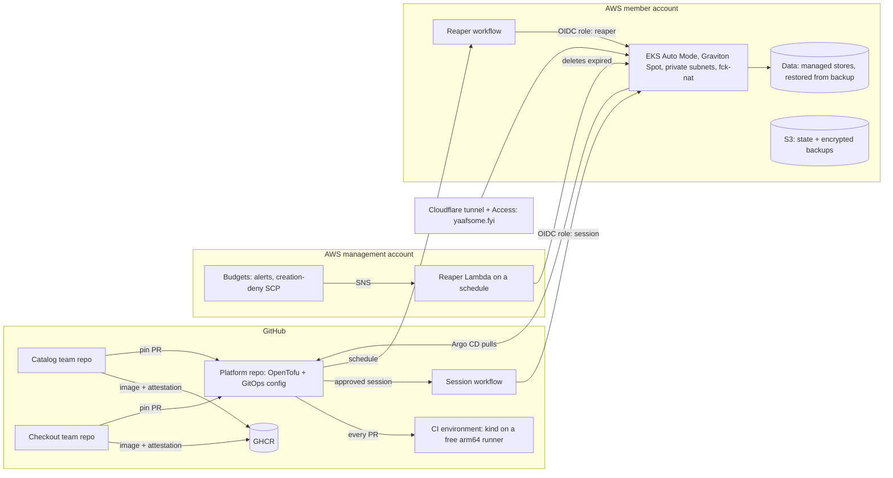

# Design draft and later stages

Moved out of `PLAN.md` on 2026-10-23 to keep the plan short. **Nothing here is binding**: it is the target design and the
stages after the ones in progress. A part becomes real when its stage starts and the owner settles it in chat; it then moves
into `PLAN.md` as a decision or a checklist. Decision numbers (D5, D6, ...) refer to `PLAN.md`.

## The architecture

Two environments built from the same git configuration. The cheap one runs on every change; the real one runs when there is
something to prove or present.

### The two environments

| | **CI environment** (every pull request, every merge) | **AWS session** (development, a demo, a drill) |
|---|---|---|
| Where | kind on GitHub's free `ubuntu-24.04-arm` runner (4 vCPU, 16 GB) | A dedicated AWS member account, one Region |
| Cluster | kind, built and thrown away in each run | EKS Auto Mode on Graviton Spot nodes, private subnets, egress through fck-nat |
| Data | In-cluster stand-ins | The managed stores of the app's AWS variant, restored from the latest backup at start, backed up at teardown |
| Proves | The delivery system: GitOps convergence, the gates, policies, manifests, the app working, smoke load | AWS behaviour: IAM and Pod Identity, networking, scaling on real nodes, managed data, recovery, cost |
| Cost | $0 (public repository) | About $0.75 per 3-hour session (up to about $1.10 with on-demand fallback and burst CPU), including the 25 minutes of create and destroy; $6–9 a month at 8 sessions |
| Lifetime | One workflow run | Time-boxed (default 3 h, at most 5 h, so create, wait and destroy fit GitHub's 6-hour job limit), destroyed by the workflow itself, with reapers as backstop |

**Why both.** The research found no evidence that reviewers value "it ran on AWS" over a well-explained local setup, but
the owner's learning goal needs real AWS behaviour, which no emulator gives (Floci ignores IAM conditions; LocalStack's
EKS is a paid tier; vendor sandboxes block EKS or OIDC). Kubernetes in CI is free, fast and a common practice (Argo CD's
own tests run k3s on GitHub runners); real AWS in short sessions costs cents. Floci is dropped.

### Components

| Layer | Choice | Why (and what production would add, *designed*) |
|---|---|---|
| **Accounts** | The owner's account is a *project* in an AWS-managed Organization (D65). At stage 2 the owner upgrades and activates advanced features and then administers that Organization: the project becomes a member account, a new management account holds only billing and the Organization, and our SCPs go on the member account | SCPs bind member accounts, not the management account, so the hard limits need that split. Until then AWS's own managed SCPs apply and cannot be changed ([research](docs/research/2026-10-13-aws-new-experience.md)). Production adds accounts per environment and a log archive (designed, as a landing zone) |
| **Network** | One VPC, two AZs, private subnets for nodes, public subnets for egress only; fck-nat instead of a managed NAT gateway | fck-nat costs about a tenth of a NAT gateway; production uses managed NAT per AZ (designed, with its cost) |
| **Cluster** | EKS Auto Mode on a standard-support Kubernetes version (`support_type = STANDARD`; extended support costs six times as much); the built-in NodePools disabled and one of our own: arm64, t4g.medium to large with m7g/c7g as fallback, Spot first and on-demand when Spot is short; managed-resource visibility turned on, because since April 2026 Auto Mode hides its instances, volumes and ENIs from `describe` calls by default, and hidden resources still bill (AWS docs, to check in stage 2) | Auto Mode runs Karpenter, load balancing, EBS CSI and the Pod Identity agent for a fee of under a cent per node-hour, which removes most add-ons a solo engineer would otherwise maintain. Watch out: t4g bursts on CPU credits, billed when it exceeds its baseline |
| **GitOps** | Self-managed Argo CD, installed once by OpenTofu; everything else is an Application in git (the gitops-bridge split: IaC hands cluster metadata to Argo CD, no Helm from OpenTofu); environments as directories (`ci`, `aws`) | Argo CD's own recommended layout; managed Argo CD (an EKS capability) is noted as an option with its price |
| **Ingress** | Gateway API with Traefik in both environments (D29); the demo is published through the Cloudflare tunnel, so no public load balancer is needed | The same routes in both environments; no inbound exposure. The AWS edge (ALB, ACM, WAF) is designed and proved once in a dedicated session |
| **Workload identity and secrets** | EKS Pod Identity; External Secrets Operator reading SSM Parameter Store (standard parameters cost nothing) | AWS's recommended workload identity; Secrets Manager with rotation is the production design (it costs $0.40 a secret a month) |
| **Data** | The app's managed stores (for the retail sample: RDS and DynamoDB, Redis on ElastiCache or in the cluster; to confirm when vendoring), smallest sizes, created per session; backups in S3 | Every session is a restore drill. Production: Multi-AZ, PITR, AWS Backup (designed, with DR tiers) |
| **Images** | Built per team repository, arm64, scanned, attested (SLSA provenance and SBOM), pushed to GHCR, pinned by digest | Free for public images; ECR with pull-through cache is the production design |
| **Policy** | Kyverno: verify image attestations, Pod Security Standards (restricted), required labels and limits | Admission-time proof that only images this pipeline built can run |
| **Observability** | kube-prometheus-stack, OpenTelemetry collector, SLOs generated by Sloth with multiwindow burn-rate alerts | Free in the cluster; Managed Prometheus and Grafana are costed in the design |
| **IaC** | OpenTofu (D5), small modules, state in S3 with native locking in the member account. Pull requests get **no AWS credentials**: `tofu test` with mock providers, Trivy, Checkov and Infracost (from the code, no plan needed). Real plans run only inside the approved session workflow | A PR can add code that `tofu plan` executes and can read state, which holds secrets; so a plan with real credentials on a PR would hand them to whoever wrote the PR |
| **Edge and names** | `yaafsome.fyi` on Cloudflare (D38): the showcase at the apex, the demo through the named tunnel with Access in front of Argo CD and Grafana (D33) | Free, and identical whichever environment is behind it |
| **Agent tooling** | AWS Knowledge MCP in the project's `.mcp.json` (no credentials); the AWS MCP Server only for the owner's own sessions | Agents can read AWS documentation and pricing without being able to touch an account |

### Names on `yaafsome.fyi`

The owner's domain is the one name for everything presented (D38). It stays on Cloudflare (registrar and DNS), so no
Route 53 hosted zone is needed and none is paid for.

| Name | What | How |
|---|---|---|
| `yaafsome.fyi` | The showcase site | Vercel, always on, free (D36) |
| `shop.yaafsome.fyi` | The store, public | The named Cloudflare tunnel into whichever environment is running (D33) |
| `argocd.yaafsome.fyi`, `grafana.yaafsome.fyi` | Operator UIs | The same tunnel, behind Cloudflare Access (an email one-time code) |
| `check.yaafsome.fyi` | The edge test page | The `edge-check` workflow |
| `aws-*@yaafsome.fyi` | Mail for the AWS accounts (management, member) and their alternate contacts | Cloudflare Email Routing (free) forwards each address to the owner's iCloud mailbox, so every account gets its own address on the domain |
| ACM certificate for `*.yaafsome.fyi` | Only for the one session that proves the AWS edge (ALB, ACM, WAF) | DNS validation record added in Cloudflare |

### Cost guardrails, in layers *(a draft for stage 2; nothing here is binding yet)*

No single control is enough, so several that fail independently. A layer is trusted only after a planted runaway shows it
working. Two rules shape all of them: **an SCP only stops new resources** (a running cluster keeps billing until
something deletes it), and **anything that deletes must still be allowed to delete** when the other layers have fired.

| # | Layer | Stops | Proved by |
|---|---|---|---|
| 1 | **SCPs on the member account** deny *creation* outside an allowlist: one Region; instance types t4g.nano (fck-nat), t4g.medium/large, m7g/c7g.large; the smallest RDS (`rds:DatabaseClass`) and cache (`elasticache:CacheNodeType`) sizes; no managed NAT gateway, Savings Plans, Reserved Instances or Marketplace; no leaving the Organization or stopping CloudTrail. Describe, list and delete are never denied | The expensive mistakes become impossible | A request for a forbidden instance type is denied while a delete still works |
| 2 | **Human approval to spend**: the session workflow runs in a GitHub environment that needs the owner's approval and deploys only from `main`. Autonomous agents (both teams and the platform's own) run as GitHub Apps without `deployments` or `actions: write`, so none can approve | No agent can start a session | An agent's attempt to approve a session through the API is refused |
| 3 | **Self-destroying sessions**: back up the data, delete the Argo CD Applications (so load balancers, ENIs and volumes from PVCs go first), then `tofu destroy`, in an `always()` step of the same job | The normal case | A session's teardown leaves nothing tagged behind |
| 4 | **The reaper workflow**: GitHub, every 30 minutes, with its own `reaper` role (trusted only for the scheduled run on `main`; describe, delete and state read): backs up what it can, then runs `tofu destroy` on any session past its `expires-at` tag; `aws-nuke` sweeps everything but the baseline only when no unexpired session exists | A teardown that failed or a runner that died | A session whose destroy step is cancelled is gone within the hour |
| 5 | **The reaper Lambda**: inside the member account, on an EventBridge schedule, written separately, deleting anything past its `expires-at` tag from one shared inventory of billable types (EKS, EC2 including fck-nat, EBS volumes, load balancers, Elastic IPs, RDS, ElastiCache, snapshots beyond retention) | GitHub's schedules being delayed or disabled (they stop after 60 days without repository activity), or a bug in layer 4 | The same planted session is gone with layer 4 switched off; a planted orphan volume is found |
| 6 | **Budgets** (in the management account, where Budgets actions must live): alerts at $5 and $10; at $15 the budget's SNS topic invokes the layer-5 Lambda in "empty the account" mode across accounts, and a Budgets action applies an SCP that denies creation only | A slow leak both reapers missed | A budget threshold set low empties the account while the SCP is attached |
| 7 | **AWS spend limit** at $20, if the account is offered it | The absolute backstop | Configured (or recorded as unavailable) |

**Worst case.** A forgotten session costs about $6 a day (the session design left running). Layer 4 or 5 removes it within
the hour. If both failed, the $15 budget fires once billing data catches up (hours, up to a day), and its Lambda can still
delete because layer 6's SCP denies only creation. Watch out: layers 5 and 6 share one Lambda, so a bug there removes both;
layer 4 is the independent path, which is why each reaper is proved with the other switched off.

**Idle cost.** Pennies, not zero: the state bucket, backups, a few parameters and short-retention log groups (every log
group is created with a retention of a few days, and EKS control-plane logging stays off unless a session needs it).

**Residual risk, said plainly.** Interactive Claude Code sessions that the owner supervises act as the owner's GitHub
identity, which can approve a deployment. `CLAUDE.md` forbids it, and layers 4 to 7 bound the cost if it ever happened.

**On the Free plan (until stage 2).** There is no Organization to attach SCPs to, no spend limit and no GitHub OIDC, so layers
1, 4 and 7 do not exist yet. The cap is the credits themselves, the owner starts and destroys each session by hand (layers 2
and 3), a Budgets alert warns when half the credits are gone, and nothing is left running between sessions. Stage 2 builds the
rest before any session is ever started from GitHub.

### When OpenTofu runs

OpenTofu (D5) is usable from the first day, in four steps. What gates each step is the identity it runs as and, for
GitHub, the OIDC provider, which AWS's managed policy denies until advanced features are activated (D65).

| Phase | What OpenTofu can do | Who runs it, and how | Needs |
|---|---|---|---|
| **Now, stage 1** | `fmt`, `validate`, `tofu test` with mock providers, Trivy and Checkov, Infracost; no plan against AWS | GitHub Actions and cloud sessions; **no AWS credentials** | Nothing |
| **Free plan, stage 2a** | A real `apply` of the bootstrap root (state and backup buckets), then a first EKS session on on-demand nodes | **The owner**, in their own terminal: AWS CloudShell until the Mac is ready, then the Mac (D64, D66); the result is committed as a log | The owner at the keyboard; the Region confirmed; credits as the cap |
| **Free plan, a look** | Read the account, never change it | Claude, through a read-only AWS identity the owner signs in with, **if** AWS offers one for this account (open question) | A read-only identity; without one, no agent access at all |
| **After advanced features, stage 2** | Every apply from GitHub Actions: `plan` on pull requests, `apply` in the approved session workflow, the reapers | GitHub, through OIDC roles (`session`, `reaper`) | Paid plan, advanced features, the OIDC provider (D6) |

**Watch out:** what AWS denies on the Free plan, Spot nodes and the OIDC provider, is exactly what the final design uses. The
interim sessions therefore cost slightly more (on-demand nodes) and cannot be started from GitHub; they prove the code and
the platform, not the automation.

### Repositories and teams

| Repository | Owner | Holds |
|---|---|---|
| `yaaf-platform` (this repository, renamed; D67) | The platform engineer (the owner) | OpenTofu, the GitOps configuration and pins, policies, workflows, scenarios, the architecture track, this plan |
| `yaaf-catalog` | The Catalog team (agents) | Its services' source, tests, Dockerfiles, its build workflow |
| `yaaf-checkout` | The Checkout team (agents) | The same for its services |

Each team is a GitHub App installed only on its repository, so an agent can change nothing else, and work arrives as issues
labelled `ready-for-agent`. Team agents run as `claude-code-action` with their App's token, not as Claude Routines, because
Routines push with the owner's identity, which can bypass rules. The ruleset on every `main` has **no bypass, not even for
admins**: pull requests only, the required checks, code-scanning results (new high findings block), dependency review and
OSV-Scanner, and a check that fails on any new dependency unless a human approves it.

## What carries over, and what goes

| Keep (it was good) | Rebuild | Drop |
|---|---|---|
| The pipeline standard (D24): pinned actions, `permissions: {}`, zizmor, actionlint, gitleaks, always-running gate jobs, the tested `changed-paths.sh` | `up` and `down` become `mise run ci-env` (kind) and the session workflow | Floci, its compose file, its quirks, its drills and guides (kept at the archive tag) |
| Image builds with attestations and the pins bot (D23, D27) | The OpenTofu roots: `org` (applied once by the owner), `account-baseline`, `session` | The `alb-ingress` module and the EC2 workstation's remains |
| Argo CD app-of-apps and Gateway API (D26, D29) | The app: vendored again (see **?** below), split into the team repositories | Online Boutique, if the retail sample is chosen |
| `mise.toml` and the lockfile (D25), the SessionStart hook, `scripts/check` (D9) | `CLAUDE.md`, rewritten for the new constraints (it still says zero AWS spend) | `mise run sandbox` and the borrowed-sandbox lane (D46): vendor sandboxes cannot run this |
| The delivery loop for agents (D41), scenarios and postmortems (D28), the tunnel and domain (D33, D38) | The guides, rewritten as each stage needs them | |

## Later stages

### Stage 2: the AWS landing zone *(needs advanced features; pennies a month)*

- [ ] The owner upgrades the account and activates advanced features (irreversible; from a written runbook), sets the
      management account's root email (`aws-mgmt@yaafsome.fyi`), and creates the member account
- [ ] `org` root: the SCPs, Budgets with the deny-all action, the spend limit if offered
- [ ] `account-baseline` root: the GitHub OIDC provider and two roles (`session`: create and destroy, trusted only for the
      approved session environment on `main`; `reaper`: describe, delete and state read, trusted only for the scheduled run
      on `main`), the state bucket with native locking, the backup bucket, Auto Mode managed-resource visibility
- [ ] Read the SCP and Budgets documentation pages themselves before writing them (the research only had summaries)
- [ ] Both reapers from one inventory of billable resource types: the scheduled workflow with the `aws-nuke`
      configuration (baseline allowlisted, skipped while a session is live), and the in-account Lambda on an EventBridge
      schedule, which the $15 budget also invokes
- [ ] Infracost on every PR that touches OpenTofu (from the code; PRs never get AWS credentials)
- [ ] Each guardrail layer proved against its planted runaway (the table above), including an agent failing to approve a
      session and the budget's Lambda deleting while the creation-deny SCP is attached

### Stage 3: the first AWS session *(about $0.65 per session, no data stores yet)*

- [ ] `session` root: the VPC with fck-nat, EKS Auto Mode with a Graviton Spot NodePool, Argo CD bootstrapped with the
      cluster's metadata; the same GitOps configuration as CI with an `aws` overlay
- [ ] The session workflow: an hours input (at most 5), the owner's approval, apply, publish through the tunnel, wait,
      destroy; create and destroy times and the session's estimated cost written to the job summary
- [ ] `hardeneks` run against the cluster and its findings recorded
- [ ] *Verified on AWS:* the shop works on EKS, end to end, and the account is empty afterwards

### Stage 4: data, identity and recovery *(adds about $0.10, so about $0.75 per session)*

- [ ] The managed stores per the app's AWS variant, smallest sizes, created by the session root
- [ ] Pod Identity for every service that touches AWS; secrets through External Secrets and Parameter Store
- [ ] Backup at teardown and in the reaper, restore at start (encrypted, in S3 with a lifecycle rule; DynamoDB with PITR
      for its export); a canary record written before the teardown measures RPO, the time to a working shop measures RTO.
      When a reaper could not back up, the RPO is the last successful backup, and the session log says so
- [ ] Proved red by a planted corrupt backup
- **?** The RTO and RPO targets (set in the architecture track)

### Stage 5: security and supply chain *($0 extra)*

- [ ] Kyverno beyond attestations (stage 1): Pod Security Standards restricted, resource limits required
- [ ] Network policies per namespace; the threat model (what each identity, token and tunnel can reach)
- [ ] Scorecard, and the rescans carried over

### Stage 6: observability and SLOs *($0 extra; nodes may grow by a few cents per session)*

- [ ] kube-prometheus-stack, the OpenTelemetry collector, dashboards as code
- [ ] SLOs for browsing and checkout with Sloth; multiwindow, multi-burn-rate alerts
- [ ] An alert proved against a planted fault under load

### Stage 7: the teams and their agents *($0 in cloud; model usage aside)*

- [ ] The team repositories, their GitHub Apps and rulesets; pin bumps flow from a team release to a platform PR
- [ ] Agents work `ready-for-agent` issues through `claude-code-action` with their App token
- [ ] Gates for agent PRs, each proved against a planted fault: scope (by repository), new-dependency check, size limit,
      code scanning as a ratchet
- [ ] DORA metrics from GitHub data

### Stage 8: customers and bad days *($0 in CI; sessions as needed)*

- [ ] Load: k6 or Locust journeys, written and varied by an agent; a spike absorbed by HPA and Auto Mode scaling,
      measured against the SLO on AWS
- [ ] Chaos Mesh experiments (a dependency down, a node lost); incidents and postmortems (D28)
- [ ] Platform scenarios: drift reverted by self-heal, lost OpenTofu state, a leaked credential, an over-broad OIDC trust
- [ ] *Optional:* one AWS FIS experiment, costed beforehand (pod actions only: Auto Mode does not support FIS instance
      termination or Spot interruption; a lost node is simulated with `kubectl delete node`)

### Stage 9: the showcase *($0)*

- [ ] The static site at `yaafsome.fyi` (D36), built from this repository: the story, the decisions, the scenario
      reports, the session log with costs, a recorded demo walkthrough (D45)
- **?** Generated from the Markdown here, or a small hand-written site

### The architecture track *(alongside every stage, `docs/architecture/`, $0)*

- [ ] Requirements and constraints: the business, the non-functional targets, the budget
- [ ] Diagrams in code (Mermaid): context, containers, the network, the delivery flow
- [ ] A Well-Architected review in the free Well-Architected Tool, exported, with a findings register; repeated after stage 8
- [ ] The production design: multi-account, Multi-AZ, managed NAT, ALB with ACM and WAF, Aurora, ECR, Managed
      Prometheus; a cost model per tier from the Pricing Calculator; DR tiers with their RTO, RPO and cost
- [ ] Security and compliance: the threat model, a PCI DSS mapping (a mapping, never a claim of compliance)
